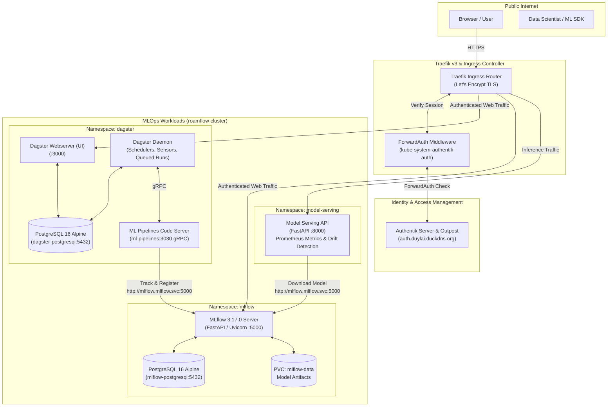

# Roamflow GitOps & MLOps Platform

[](https://k3s.io/)
[](https://arm.com)
[](https://argo-cd.readthedocs.io/)
[](https://goauthentik.io/)
[](https://mlflow.org)

Declarative GitOps repository and infrastructure definitions for **`roamflow`**, a multi-node ARM64 Kubernetes cluster hosted on Oracle Cloud Infrastructure (OCI Always Free Tier). It hosts production-grade developer tooling, monitoring, and an end-to-end modern **MLOps platform (MLflow + Dagster)** secured by **Authentik Single Sign-On (SSO)**.

---

## Architecture Overview



---

## Services & Exposed Endpoints

All services are exposed via Traefik with automatic Let's Encrypt certificates issued by `cert-manager`:

| Service | Namespace | Hostname | Description | Authentication |
| :--- | :--- | :--- | :--- | :--- |
| **Dagster Platform** | `dagster` | `https://dagster.duylai.duckdns.org` | Asset-based data & ML orchestrator UI | Authentik SSO (ForwardAuth) |
| **MLflow Server** | `mlflow` | `https://mlflow.duylai.duckdns.org` | Experiment tracking & model registry (v3.17.0) | Authentik SSO (ForwardAuth) |
| **Model Serving** | `model-serving` | `https://serving.duylai.duckdns.org` | Real-time ML inference API & drift monitoring (FastAPI) | Public / Direct |
| **Authentik SSO** | `authentik` | `https://auth.duylai.duckdns.org` | Centralized identity provider & proxy outpost | Native Authentik Auth |
| **Grafana Dashboards** | `monitoring` | `https://grafana.duylai.duckdns.org` | Metrics visualization & cluster dashboards | Authentik OIDC OAuth |
| **Headlamp** | `headlamp` | `https://headlamp.duylai.duckdns.org` | Kubernetes cluster management dashboard | Authentik SSO (ForwardAuth) |
| **Stirling PDF** | `stirling-pdf` | `https://pdf.duylai.duckdns.org` | Web-based PDF manipulation utilities | Public / Direct |
| **Changedetection** | `changedetection` | `https://changedetection.duylai.duckdns.org` | Website & API change detection and monitoring | Authentik SSO (ForwardAuth) |
| **Mealie** | `mealie` | `https://mealie.duylai.duckdns.org` | Recipe manager and meal planner | Direct (Native Auth) |
| **Argo CD** | `argocd` | `https://argocd.duylai.duckdns.org` | Declarative GitOps deployment engine | Authentik OIDC OAuth (or Local Admin) |

---

## MLOps Stack Deep Dive

### 1. MLflow Tracking Server (`apps/mlflow`)
* **Engine**: MLflow `v3.17.0` running on FastAPI / Uvicorn with native `linux/arm64` support.
* **Backend Store**: Dedicated `mlflow-postgresql` (`postgres:16-alpine`) database pod with persistent storage (`mlflow-postgresql-data`).
* **Artifact Store**: 10 GiB `local-path` PersistentVolumeClaim (`mlflow-data`) storing model artifacts and run outputs.
* **Resource Optimization**: Tuned with `--workers 1` (Uvicorn async), `requests: 1.5Gi`, and `limits: 3Gi` to ensure zero OOM crashes while maintaining high throughput.
* **Internal Networking**: Other pods inside the cluster communicate directly via `http://mlflow.mlflow.svc.cluster.local:5000`, bypassing Ingress authentication.

### 2. Dagster Data Platform (`apps/dagster`)
* **Architecture**: Fully modular setup separating control plane, code location, and storage:
  * `dagster-postgresql`: Dedicated `postgres:16-alpine` database pod (~40 MB RAM) holding run logs, schedules, and event records.
  * `dagster-webserver`: Interactive UI on port 3000.
  * `dagster-daemon`: Background supervisor running `AssetDaemon`, `SchedulerDaemon`, `SensorDaemon`, and `QueuedRunCoordinatorDaemon`.
* **Code Location Integration**: Communicates via gRPC with `ml-pipelines` code server (`http://ml-pipelines:3030`).

### 3. ML Pipelines (`apps/ml-pipelines`)
* **Role**: Dagster gRPC User Code Location container running the actual data loading, training, and model registration pipelines.
* **Quality Gate**: Includes data extraction, preprocessing, model training, evaluation, and quality gate assertions (e.g. Accuracy >= 0.90) before registering candidate models to the MLflow Model Registry.

### 4. Model Serving & Observability (`apps/model-serving`)
* **Role**: Low-latency production inference service built on FastAPI.
* **Lifecycle**: Automatically loads registered production models from MLflow (`http://mlflow.mlflow.svc:5000/api/2.0/mlflow/models/get-latest-versions`).
* **Observability & Drift**: Exposes `/metrics` with custom Prometheus metrics and statistical data drift detection (Wasserstein Distance and Kolmogorov-Smirnov p-values), visualized via custom Grafana dashboards.

---

## Single Sign-On (SSO) Workflow

Web UIs without built-in OIDC support (MLflow, Dagster, Headlamp, Changedetection) are protected using **Traefik ForwardAuth**:

1. **Ingress Middleware**: Ingress manifests include:
   ```yaml
   traefik.ingress.kubernetes.io/router.middlewares: kube-system-redirect-https@kubernetescrd,kube-system-authentik-auth@kubernetescrd
   ```
2. **Authentik Proxy Provider Configuration**:
   * In Authentik Admin Console (`https://auth.duylai.duckdns.org`), create a **Proxy Provider**:
     * **Mode**: `Forward auth (single application)`
     * **External host**: `https://<service>.duylai.duckdns.org`
     * **Authentication URL**: `https://auth.duylai.duckdns.org`
   * Bind the Provider to an Application and assign it to the `authentik Embedded Outpost`.

---

## GitOps Repository Structure

```text
devops/
├── bootstrap/                          # Cluster initialization scripts
├── clusters/
│   └── roamflow/                       # Root App-of-Apps & Application manifests
│       ├── root-app.yaml               # Entrypoint application
│       ├── infrastructure.yaml         # Core cluster components (cert-manager, middlewares)
│       ├── authentik.yaml              # Argo CD Application for Authentik SSO
│       ├── changedetection.yaml        # Argo CD Application for Changedetection.io
│       ├── dagster.yaml                # Argo CD Application for Dagster
│       ├── headlamp.yaml               # Argo CD Application for Headlamp
│       ├── ml-pipelines.yaml           # Argo CD Application for ML Pipelines
│       ├── mlflow.yaml                 # Argo CD Application for MLflow
│       ├── model-serving.yaml          # Argo CD Application for Model Serving
│       ├── monitoring.yaml             # Argo CD Application for Prometheus & Grafana stack
│       ├── stirling-pdf.yaml           # Argo CD Application for Stirling-PDF
│       └── kustomization.yaml
├── infrastructure/                     # Cluster-wide resources
│   ├── cert-manager/                   # Let's Encrypt ACME ClusterIssuer
│   ├── middlewares/                    # Traefik redirect-https & authentik-auth
│   ├── argocd/                         # Argo CD Ingress
│   └── kustomization.yaml
└── apps/                               # Standardized Helm Charts
    ├── authentik/                      # Identity & SSO platform (Helm umbrella chart)
    ├── changedetection/                # Website & API monitor with Playwright sidecar (Helm chart)
    ├── dagster/                        # Dagster Webserver, Daemon & PostgreSQL (Helm chart)
    ├── headlamp/                       # Headlamp Kubernetes dashboard (Helm chart)
    ├── ml-pipelines/                   # Dagster gRPC User Code Location for ML (Helm chart)
    ├── mlflow/                         # MLflow 3.17.0 Tracking Server & PostgreSQL (Helm chart)
    ├── model-serving/                  # FastAPI inference API & drift monitoring (Helm chart)
    ├── monitoring/                     # Prometheus, Grafana, Loki & Promtail stack (Helm chart)
    └── stirling-pdf/                   # Stirling-PDF Web Tool (Helm umbrella chart)
```

---

## Secrets Management (Bitnami Sealed Secrets)

All sensitive data committed to Git is encrypted using Bitnami Sealed Secrets (`kubeseal`):

```bash
# 1. Create a local unencrypted secret (do NOT commit)
kubectl create secret generic my-secret \
  --namespace my-namespace \
  --from-literal=PASSWORD=supersecret \
  --dry-run=client -o yaml > secret.yaml

# 2. Encrypt with kubeseal
kubeseal --controller-name=sealed-secrets-controller \
  --controller-namespace=kube-system \
  --format yaml < secret.yaml > apps/my-app/sealed-secret.yaml

# 3. Safely commit sealed-secret.yaml to Git
git add apps/my-app/sealed-secret.yaml
git commit -m "feat(secret): add encrypted secret"
git push origin main
```

---

## Operations & Verification

```bash
# Verify Argo CD applications status
kubectl get applications -n argocd

# Check all pods in the MLOps namespaces
kubectl get pods -n mlflow
kubectl get pods -n dagster

# Test Kustomize builds locally
kubectl kustomize apps/mlflow/
kubectl kustomize apps/dagster/
kubectl kustomize clusters/roamflow/

# Check certificate readiness
kubectl get certificates -A
```

---

## License

Personal project repository maintained by [Duy Lai](https://github.com/roamflow). Distributed for private infrastructure management.
